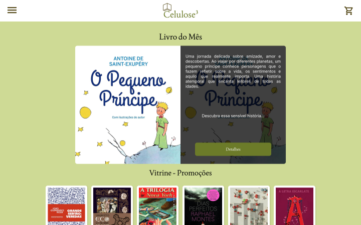
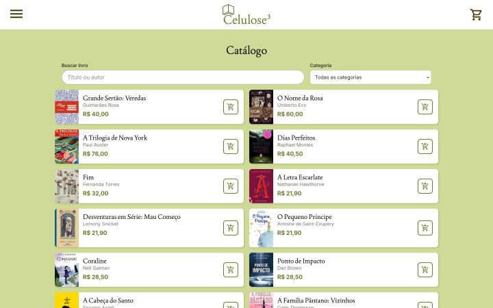
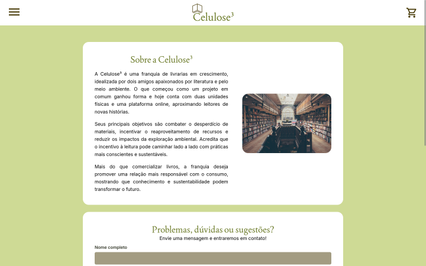
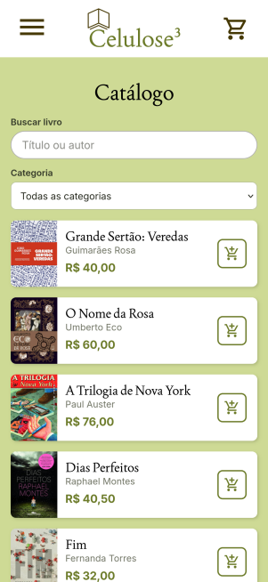
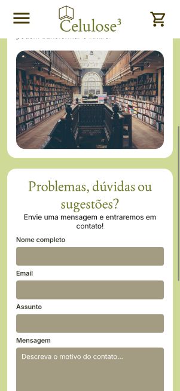

# Celulose³ — Livraria

**Integrantes:**
- Breno Santana Silva
- Clarice Miranda de

## Sobre o projeto

A **Celulose³** é uma livraria fictícia que busca aproximar leitores de novas histórias, incentivando também o consumo consciente e a sustentabilidade. O projeto foi desenvolvido como atividade acadêmica para aplicar conhecimentos de desenvolvimento web, utilizando HTML, CSS e JavaScript.

O site apresenta uma página inicial, um catálogo de livros, detalhes das obras, um carrinho de compras e uma página de contato.

## Tecnologias utilizadas

- **HTML5:** utilizado para estruturar o conteúdo das páginas, organizando os elementos de forma semântica.
- **CSS3:** responsável pela identidade visual, estilização dos componentes, animações e adaptação do layout para diferentes tamanhos de tela.
- **JavaScript (ES6+):** utilizado para implementar a interatividade do site, renderizar os livros dinamicamente, controlar o carrinho, realizar buscas e validar formulários.
- **localStorage:** utilizado para armazenar os itens do carrinho no navegador, permitindo que eles permaneçam salvos mesmo após recarregar a página ou navegar entre as páginas do site.
- **Google Fonts:** utilizado para carregar as fontes Joan e Inter, contribuindo para a identidade visual da livraria.

A escolha dessas tecnologias permite desenvolver uma aplicação web interativa sem a necessidade de frameworks ou ferramentas de build adicionais.

## Funcionalidades implementadas

### Página inicial
- Cabeçalho com logotipo e menu de navegação.
- Menu adaptável para dispositivos móveis.
- Banner de destaque com o livro do mês.
- Vitrine de livros em promoção, gerada dinamicamente com JavaScript.
- Botão para acessar o catálogo.
- Seção de newsletter com formulário de inscrição e mensagem de confirmação.

### Catálogo
- Exibição dinâmica dos livros cadastrados.
- Busca de livros por título ou autor.
- Filtro de livros por categoria.
- Possibilidade de combinar a busca com o filtro de categoria.
- Acesso aos detalhes de cada livro.
- Botão para adicionar livros diretamente ao carrinho.

### Detalhes dos livros
- Exibição ampliada da capa.
- Apresentação da sinopse, autor, editora, ano de publicação, número de páginas, categoria e preço.
- Botão para adicionar o livro ao carrinho.
- Acesso ao catálogo.

### Carrinho de compras
- Carrinho lateral acessível pelo cabeçalho das páginas.
- Adição de livros ao carrinho.
- Alteração da quantidade de cada item.
- Remoção individual de produtos.
- Opção para limpar o carrinho.
- Cálculo automático do subtotal e do valor total.
- Contador de itens exibido no ícone do carrinho.
- Persistência dos dados utilizando `localStorage`.
- Compartilhamento do mesmo carrinho entre as páginas do site.

### Contato / Sobre
- Apresentação da história e dos objetivos da livraria.
- Informações de contato e endereços.
- Formulário com campos para nome, e-mail, assunto e mensagem.
- Validação dos campos obrigatórios e do formato do e-mail.
- Exibição de mensagem de confirmação após o envio.

### Recursos adicionais
- Layout responsivo para celulares, tablets e computadores.
- Efeitos de hover e transições em botões e cards.
- Mensagens temporárias de confirmação ao adicionar livros ao carrinho.
- Cuidados com acessibilidade, incluindo textos alternativos para imagens, rótulos nos campos e atributos ARIA em componentes interativos.

**Observação:** os formulários de contato e newsletter simulam o envio e exibem uma confirmação na interface. O projeto não possui integração com um servidor ou serviço externo para transmitir os dados.

## Como executar o projeto localmente

O projeto utiliza módulos JavaScript, portanto deve ser executado por meio de um servidor HTTP local, e não abrindo os arquivos HTML diretamente pelo navegador.

### Pré-requisitos

- Python 3 instalado (ou outro servidor HTTP local como extensão do VSCode).
- Navegador atualizado.

### Passos

1. Faça o download ou clone o repositório do projeto.
2. Abra um terminal na pasta raiz do projeto.
3. Inicie um servidor HTTP local com o comando:

```bash
python3 -m http.server 8000
```

4. Abra o navegador e acesse:

```text
http://localhost:8000
```

A página inicial será carregada. Utilize o menu de navegação para acessar o catálogo e a página de contato.

## Capturas de tela

### Desktop

**Página inicial**



**Catálogo**



**Contato**



### Celular

**Página inicial**


**Catálogo**



**Contato**



---

**Celulose³ — Conhecimento e sustentabilidade em cada página.**
